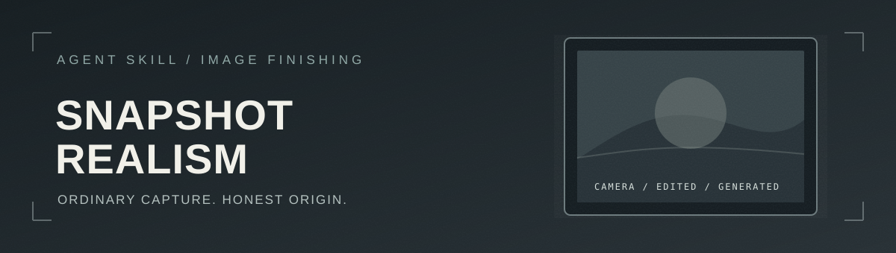
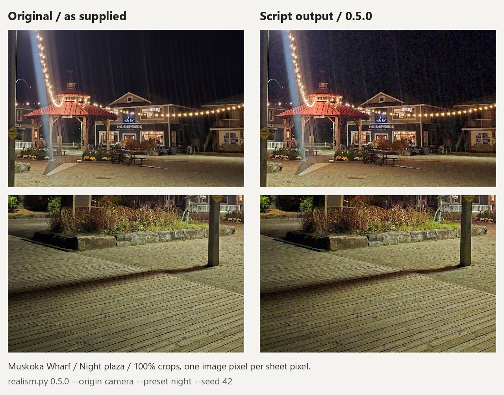
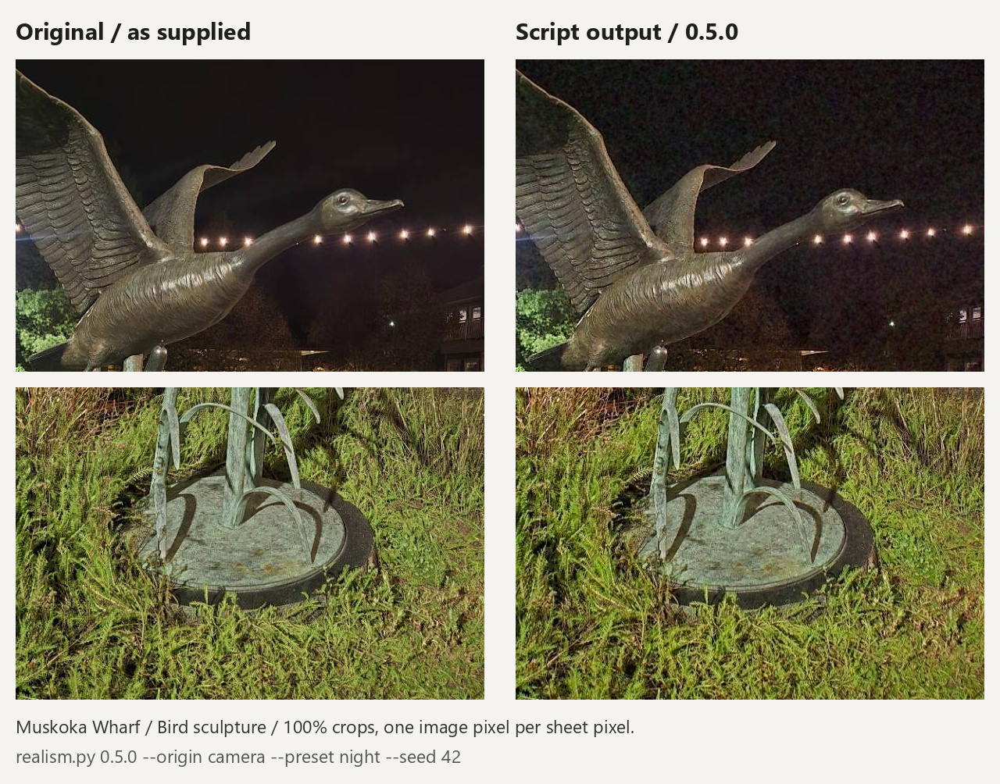
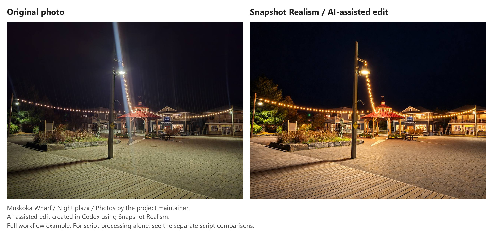
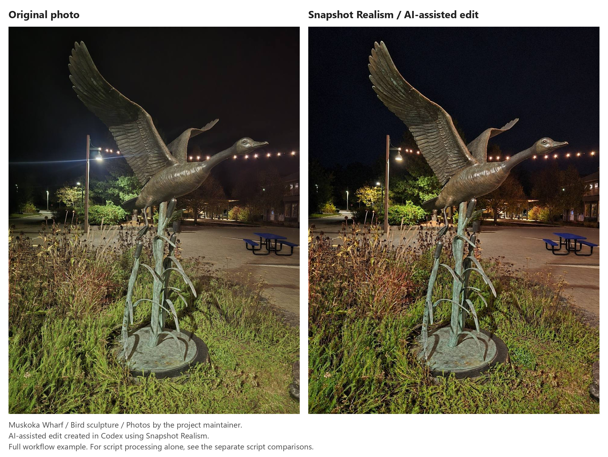
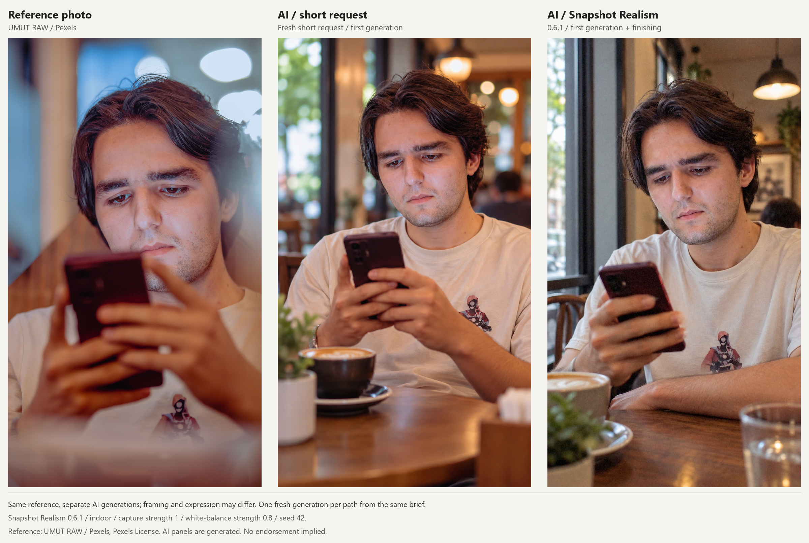
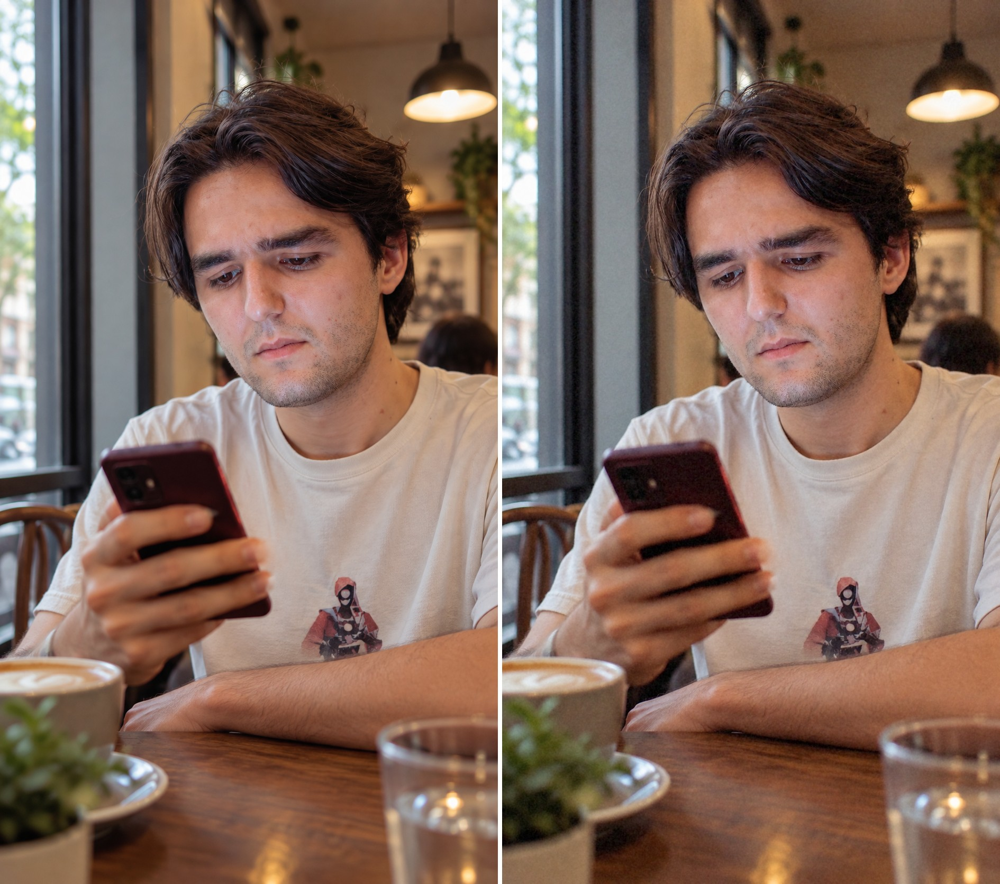

<p align="center">
  
</p>

<h1 align="center">Snapshot Realism</h1>

<p align="center">
  <strong>Make a photo feel like a photo. Keep its origin honest.</strong><br/>
  A camera-aware Agent Skill for less polished images and controlled phone-style finishing.
</p>

<p align="center">
  <a href="LICENSE"></a>
  
  
  
  <a href="https://github.com/RZ-Logic/snapshot-realism-skill/actions/workflows/tests.yml"></a>
</p>

<p align="center">
  <a href="#why-this-exists">Why</a> ·
  <a href="#the-principle">Principle</a> ·
  <a href="#demo">Examples</a> ·
  <a href="#does-it-work">Does It Work</a> ·
  <a href="#what-ships">What Ships</a> ·
  <a href="#quickstart">Quickstart</a> ·
  <a href="#quality-gates">Quality Gates</a> ·
  <a href="#provenance">Provenance</a> ·
  <a href="#related-work">Related Work</a> ·
  <a href="#limits">Limits</a> ·
  <a href="#installation">Installation</a> ·
  <a href="#reference">Reference</a> ·
  <a href="#verification">Verification</a>
</p>

---

<a id="why-this-exists"></a>
## 🧭 Why this exists

An image can have convincing objects and still feel manufactured: uniformly clean shadows, warm skin and walls, crisp hair and fabric, and a background with no camera noise. Asking an image model to "make it more real" often rebuilds the same scene with a grain filter on top. A grain filter does not change a staged pose, impossible lighting, or a too-perfect background.

Snapshot Realism separates those jobs. For **newly generated scenes**, the skill rewrites the request in capture terms and checks the result before a deterministic finishing pass. For **genuine camera photos**, it adds no capture texture by default and fixes only the imperfections you name, such as flare or haze, with a conservative AI edit.

**Scope.** The skill is for fictional people, your own likeness, or people who gave permission. When a real person is supplied as a reference, it asks you to confirm that it is you or someone who consented before it edits. Any edit of a real person's likeness is declared `generated` (or `edited`, for an inpaint on their camera photo), never `camera`. Never use it to hide that an image is AI-generated or to pass a generated image off as a camera photo.

<a id="the-principle"></a>
## 🧱 The principle

> **Structure first; capture texture second. Provenance is an explicit choice, never a visual guess.**

The prompt recipe addresses pose, light, framing, and other structural tells. `realism.py` addresses color and capture artifacts: white balance, imperfect optics, noise reduction, shadow noise, sharpening, and JPEG output. Neither step proves that an image came from a camera.

```text
Camera photo ─► fix named imperfections (optional AI edit) ──┐
Camera photo with AI inpainting ─────────────────────────────┤
                                                             ├─► realism.py ─► processed JPEG + comparison
New scene ─► prompt ─► generate ─► QA ───────────────────────┘       │
                                                        --origin camera | edited | generated
```

Three origins, each declared by you:

- **`camera`**: a genuine photo. The script adds no capture effects to it by default, because a real photo already has real phone texture.
- **`edited`**: a camera photo with AI-generated parts, such as inpainting.
- **`generated`**: made by an image model, including a scene regenerated from a reference photo.

<a id="demo"></a>
## 📷 Examples

### Muskoka Wharf: the script on a real camera photo

Two night photographs taken by the project maintainer at Muskoka Wharf. These pairs isolate the deterministic finishing script, run at capture strength 1 to show what it does. Since 0.6.2 the script adds nothing to a camera photo by default; for your own photos, fix camera imperfections instead (see [Quickstart](#quickstart)). Each original went through the same command:

```bash
python skill/snapshot-realism/scripts/realism.py assets/demo/muskoka-wharf/plaza-before.jpg --origin camera --preset night --capture-strength 1 --seed 42 -o plaza-script.jpg
```

The sheets below show a 100% crop of the original on the left and of the script output on the right. The full outputs are [`plaza-script.jpg`](assets/demo/muskoka-wharf/plaza-script.jpg) and [`sculpture-script.jpg`](assets/demo/muskoka-wharf/sculpture-script.jpg).

**Night plaza**

[](assets/demo/muskoka-wharf/plaza-script-crops.jpg)

**Bird sculpture**

[](assets/demo/muskoka-wharf/sculpture-script-crops.jpg)

### Muskoka Wharf: Snapshot Realism photo edits

These before-and-after pairs were created in Codex using Snapshot Realism. They show AI-assisted photo editing, including light-streak removal and changes to scene detail. Codex's image model removed the streaks and regenerated each scene from Codex's own restoration-edit prompt; `realism.py` then finished the result, and Codex exported it as Ultra HDR. The script has no flare-removal step; since 0.6.2 the skill's camera path asks the image model for it. The edited files carry the AI-generated label in their metadata. The script-only comparisons above isolate `realism.py`.

[](assets/demo/muskoka-wharf/plaza-comparison.jpg)

[](assets/demo/muskoka-wharf/sculpture-comparison.jpg)

[Open all the Wharf files and provenance notes](assets/demo/muskoka-wharf/README.md).

### Candid male portrait: ordinary AI request and Snapshot Realism

Both AI versions use the same [reference photo by UMUT RAW via Pexels](https://www.pexels.com/photo/candid-picture-of-a-young-man-sitting-and-using-phone-16829778/) and the same brief: a fresh waist-up café photo, using the reference for appearance and clothing. The ordinary path uses the short request. Snapshot Realism expands it with the 0.6.1 prompt recipe, then runs the script. Each path used one generation with the same image tool in the same session.

[](assets/demo/candid-male/workflow-comparison.jpg)

Pose, expression and background differences come from generation; the script adds capture texture and JPEG finishing. Some lens-like background softness remains. This pair illustrates the workflow; it does not establish consistent superiority.

**Script alone: the skill's own generated input before and after finishing**

[](assets/demo/candid-male/script-comparison.jpg)

[Exact prompts, settings, source credit and reproduction command](assets/demo/candid-male/README.md). The reference appears only inside the labelled comparison; its unchanged standalone file is linked from Pexels rather than bundled here. [Image rights and credits](assets/demo/IMAGE-LICENSES.md) are separate from the code's MIT license.

<a id="does-it-work"></a>
## 📏 Does it work?

The tables below are generated by `python tools/measure.py --readme`. The first runs the script on synthetic flat patches and step edges and reports the texture properties the tests pin, so a regression in the grain, the sharpening or the black level shows up as a number. The second runs it on the demo photos.

<!-- measure:start -->
Measured with `realism.py 0.6.2` by `python tools/measure.py` (numpy 2.5.4, Pillow 12.3.0).

| Preset | Strength | Luma std at 118 (DN) | Lag-2 autocorrelation at 60 | Std at 60, sharpened / not (DN) | Mean shift at 0 / 20 / 128 (DN) | Edge overshoot (DN) | CA k | Sharpen |
|---|---|---|---|---|---|---|---|---|
| day | 0.5 | 0.57 | 0.25 | 0.71 / 0.71 | +0.12 / -0.00 / +0.00 | 9.4 | 0.0005 | 0.23 |
| day | 1 | 1.02 | 0.29 | 1.31 / 1.31 | +0.14 / +0.00 / -0.00 | 18.8 | 0.0010 | 0.45 |
| day | 2 | 1.91 | 0.32 | 2.49 / 2.49 | +0.14 / -0.00 / -0.00 | 18.8 | 0.0015 | 0.45 |
| day | 3 | 2.76 | 0.34 | 3.60 / 3.60 | +0.14 / -0.00 / +0.00 | 18.8 | 0.0015 | 0.45 |
| indoor | 0.5 | 1.10 | 0.31 | 1.41 / 1.41 | +0.14 / +0.00 / -0.00 | 8.4 | 0.0005 | 0.20 |
| indoor | 1 | 2.00 | 0.35 | 2.59 / 2.59 | +0.13 / -0.00 / +0.00 | 16.7 | 0.0010 | 0.40 |
| indoor | 2 | 3.45 | 0.43 | 4.48 / 4.48 | +0.11 / +0.01 / +0.00 | 16.7 | 0.0015 | 0.40 |
| indoor | 3 | 4.79 | 0.48 | 6.20 / 6.20 | +0.10 / +0.11 / +0.00 | 16.7 | 0.0015 | 0.40 |
| night | 0.5 | 1.61 | 0.34 | 2.09 / 2.09 | +0.13 / -0.00 / -0.00 | 6.2 | 0.0005 | 0.15 |
| night | 1 | 2.83 | 0.41 | 3.68 / 3.68 | +0.11 / +0.00 / +0.00 | 12.5 | 0.0010 | 0.30 |
| night | 2 | 5.05 | 0.48 | 6.52 / 6.52 | +0.10 / +0.13 / -0.00 | 12.5 | 0.0015 | 0.30 |
| night | 3 | 7.55 | 0.48 | 9.64 / 9.64 | +0.10 / +0.46 / +0.00 | 12.5 | 0.0015 | 0.30 |

Grain: the luma standard deviation of a flat 256 px gray patch at sRGB 118, and how strongly each pixel's grain resembles the pixel two to its right (0 is single-pixel speckle; higher is mottled grain a few pixels wide).
Sharpening: the grain on a flat patch at 60 with sharpening on and with it switched off; equal numbers mean flat areas are not sharpened.
Black level: how far the average of a flat 128 px patch at 0, 20 and 128 moves; numbers near 0 mean the noise is zero-mean and does not lift shadows.
Edges: the bright-side overshoot of a 50 to 200 step at the frame center (green channel), and the color-fringing scale and sharpening amount the script passes on at the default `--ca 0.001`.

| Input | Origin, preset | Mean change at 1080 px wide (DN) | Mean change at native size (DN) | White balance line |
|---|---|---|---|---|
| `plaza-before.jpg` (1280x960) | camera, night | 4.08 | 4.20 | white balance: off for camera photos (green or magenta surface, likely colored rather than a cast; --wb-strength 0.8 turns it on) |
| `sculpture-before.jpg` (960x1280) | camera, night | 4.72 | 4.77 | white balance: off for camera photos (no near-neutral surface found; --wb-strength 0.8 turns it on) |
| `skill-before-script.png` (941x1672) | generated, indoor | 2.47 | 2.48 | white balance: no change (cool light left alone) |

Photos: the average per-channel change between the decoded input and the script output, with seed 42 and the settings in the demo READMEs, both at the file's own size and with both resized to 1080 px wide as a feed shows them (an upscale for inputs narrower than 1080 px), plus the white balance line the script printed.
<!-- measure:end -->

Measured the same way (`python tools/measure.py --script <older realism.py>`), 0.4.0 lifted a black patch by up to 11.6 DN (night, strength 3), its sharpening raised flat-area grain by up to 1.9x (day, strength 3), and its grain was single-pixel speckle (lag-2 autocorrelation 0.06 or less).

What this does not show: whether people read the output as a phone photo. [`tools/blind_test.py`](tools/blind_test.py) builds side-by-side sheets in random order and scores how often the processed image is picked as the phone photo, with a one-sided binomial p-value. **No blind test has been run yet**, so there is no evidence of how the output reads to people. There is also no controlled set of camera photos; the Wharf and portrait examples are illustrations. The 0.2.0 to 0.3.0 white-balance measurements, made on two fixtures that have since left the repository, are in the [0.3.0 changelog](CHANGELOG.md).

<a id="what-ships"></a>
## 📦 What ships

| Part | Role |
|---|---|
| [Skill instructions](skill/snapshot-realism/SKILL.md) | Chooses the camera-photo, edited or generated workflow and checks the result. |
| [Prompt recipe](skill/snapshot-realism/references/prompt-recipe.md) | Rewrites new scenes around capture, subject, moment, light, framing, and artifacts; holds the word tiers and both quality gates. |
| [`realism.py`](skill/snapshot-realism/scripts/realism.py) | Applies deterministic finishing and writes provenance-aware JPEG metadata; with `--sign`, a signed C2PA manifest. |
| [`make_cert.py`](skill/snapshot-realism/scripts/make_cert.py) | Makes a private signing certificate for `--sign`: a root and a signing certificate issued by it. |
| [`agents/openai.yaml`](skill/snapshot-realism/agents/openai.yaml) | Display name, short description and default prompt for Codex's skill list. |
| [`requirements.txt`](requirements.txt) | NumPy and Pillow, with the oldest supported versions. |
| [`chatgpt/project-instructions.md`](chatgpt/project-instructions.md) | A separate copy-and-paste version of the workflow for a ChatGPT Project. |
| [`realism.bat`](realism.bat) | Windows drag-and-drop launcher; asks origin, light level and capture strength for each input. |
| [`tools/build_zip.py`](tools/build_zip.py) | Builds the Agent Skills ZIP in `dist/` and checks it against the source. |
| [`tools/release_notes.py`](tools/release_notes.py) | Prints the changelog section for the current version; the release workflow uses it as the notes. |
| [`tools/measure.py`](tools/measure.py) | Measures the capture texture and generates the tables above. |
| [`tools/blind_test.py`](tools/blind_test.py) | Builds blind side-by-side sheets and scores the answers. |
| [Tests](tests/) | Color and white balance, input modes, noise, provenance, CLI safety, launcher, blind-test kit, packaging. |
| [Changelog](CHANGELOG.md) | What changed in each version. |

The Python script runs locally with NumPy and Pillow. It does not call an image-generation API, and it makes no network request, with or without `--sign`.

<a id="quickstart"></a>
## ⚡ Quickstart

From a fresh clone of this repository, this runs the script on the portrait example and writes two files in the current folder:

```bash
python -m pip install -r requirements.txt
python skill/snapshot-realism/scripts/realism.py assets/demo/candid-male/skill-before-script.png --origin generated --preset indoor --capture-strength 1 --wb-strength 0.8 --seed 42 --max-edge 1672 --compare -o portrait-check.jpg
```

That creates `portrait-check.jpg` and `portrait-check_compare.jpg` (before and after side by side) in the current folder, and prints the paths. These settings reproduce the portrait demo: indoor preset, capture strength 1 and white-balance strength 0.8. On this image, the script reports that it leaves the cool light alone.

`--origin` and `--preset` are required on every run; there is no default for either. Choose the preset from the *actual light level* of the scene, then inspect the output at normal size and at 100%.

For a **genuine camera photo**, the script adds no capture effects by default: a real photo already has real phone texture. To fix a camera imperfection such as flare, light streaks, ghosting, haze or dust, first make a conservative AI edit ("Remove the flare. Change nothing else: keep every lamp, sign, word of text, sculpture and building exactly as it is."), compare signs and text with the original at 100%, then label the result without changing its color, size or texture. Use `--origin generated` when the image model returned a whole new frame, as Codex and ChatGPT do, and `edited` only for a masked inpaint that kept the other pixels:

```bash
python skill/snapshot-realism/scripts/realism.py photo-fixed.png --origin generated --preset night --capture-strength 0 --wb-strength 0 --max-edge 8192 --quality 95
```

For a **camera photo with AI-generated parts** (inpainting):

```bash
python skill/snapshot-realism/scripts/realism.py edited.png --origin edited --preset day --compare
```

For a **newly generated image**, including a scene regenerated from a reference photo:

```bash
python skill/snapshot-realism/scripts/realism.py scene.png --origin generated --preset night --compare
```

Without `-o`, the last command writes `scene_real.jpg` and `scene_real_compare.jpg` next to the input and prints the path it wrote. If `scene_real.jpg` (or its comparison) already exists, the next run writes `scene_real-2.jpg`, then `scene_real-3.jpg`. The input file is never overwritten, even with `--overwrite`.

To also **sign** the output with C2PA Content Credentials that keep the input's own (optional; Python 3.10+), install c2pa-python, make a private certificate once, then add `--sign`:

```bash
python -m pip install c2pa-python
python skill/snapshot-realism/scripts/make_cert.py .
python skill/snapshot-realism/scripts/realism.py scene.png --origin generated --preset night --sign signer-chain.pem signer-key.pem
```

See [Signed Content Credentials](#signing) for what the manifest holds and how validators show a private signer.

**Capture strength is independent of light level.** The default is `0.5` for generated and edited images and `0` for camera photos; use `1` for a stronger finish, `2` for strong, or `3` for the maximum. Keep the preset matched to the scene; do not choose `night` just to increase the effect. For example, a stronger daylight finish is:

```bash
python skill/snapshot-realism/scripts/realism.py scene.png --origin generated --preset day --capture-strength 2 --compare
```

Strength means how rough the capture was. It raises noise and noise reduction; noise reduction stops at a cap (luma smear 0.5, chroma blur 6.0), so the highest strengths read as more grain rather than as smear or color blotches. Sharpening never exceeds the preset, and color fringing stops growing at 1.5x, so strengths 2 and 3 add noise and smear without more sharpening and with no more fringing than strength 1.5. At `0`, the capture effects are bypassed; white balance, manual warmth, resizing, JPEG quality and origin handling still apply. Output differs from 0.4.0 at every strength. Inspect stronger settings at 100% and lower the strength if the artifacts look artificial.

The preset values below apply at capture strength `1`:

| Preset | Intended scene | Noise and smear | Sharpening | JPEG quality |
|---|---|---|---|---|
| `day` | Daylight | Light noise, minimal smear | 0.45 | 90 |
| `indoor` | Rooms and evening light | Moderate noise, light smear | 0.40 | 88 |
| `night` | Night streets, bars, concerts | Stronger shadow noise and smear | 0.30 | 85 |

Grain is strongest in the shadows and rolls off toward the highlights, and color noise fades faster than luma grain, so a bright shirt or wall shows fine neutral grain rather than color blotches. Sharpening is weakest at night, where it would boost noise. For every preset, sharpening applies to edges only and tapers toward the corners. The script adds no vignetting, because phones correct lens shading in software.

<a id="quality-gates"></a>
## 🚦 Quality gates

For a newly generated scene, the skill checks the image before running the script. The full text is in the [prompt recipe](skill/snapshot-realism/references/prompt-recipe.md).

1. **Rewrite the request** with the recipe: capture, subject, moment, light, framing, artifacts. Pure polish words (8k, masterpiece, photorealistic) are dropped. Words that can carry a real requirement (soft light, bokeh, golden hour, beautiful) are translated by intent instead of deleted, and the agent tells you what it dropped and translated. Night prompts describe what a phone night shot looks like rather than pairing "iPhone" with "high ISO, grainy", and the artifacts slot asks for one or two imperfections, because a full checklist of flaws becomes its own uniform tell. Generated rooms drift toward a showroom, so the setting is named specifically and as it is used ("a rented one-bedroom living room", not "a modern living room"), the named light falls off across the room instead of lighting every wall evenly, and the frame gets tighter when a wide room would show more staged background than the request needs. House plants and flowers are kept out unless asked: the prompt names what sits on the surfaces near the subject and ends with "No house plants or flowers." In a blind 54-image Codex test that kept plants out of all 27 images, against 22 of 27 without it. Style words such as modern, minimalist, luxury, aesthetic and cozy are translated into a specific real place. Clutter, stains and wear are not added by default: a new sofa or a hotel room can be pristine, and the recipe's examples are patterns, not phrases to reuse.
2. **Gate A, blocking.** Any one of these means regenerate (or crop it out, if cropping leaves a usable image): broken anatomy (extra, fused or missing fingers or limbs, warped face, impossible joints); readable text that is garbled or reversed (signs, shirt prints, labels); identity drift from a supplied reference; physically impossible light or reflections, or clearly impossible object construction or support (a floating shelf, fused furniture legs); the image does not show what was asked.
3. **Gate B, stylistic tells, counted.** Centered pose with eye contact and a closed-mouth smirk; a symmetric, poreless or airbrushed face; glossy hair clumps with no flyaways; even flattering light on a night scene; creamy uniform background blur; a showroom background in a place meant to look lived in (objects lined up or evenly spaced, identical repeats, uniformly plump upholstery), or any unasked house plant or flowers, with all of its signs counted as one tell. Two or more, or one background tell you asked to fix, means regenerate with a new prompt that pushes harder on the failed slot. The agent checks the two or three most prominent background objects, judges visible defects rather than tidiness, and says which objects it checked.
4. **Cap.** After 3 regenerations, a remaining Gate A defect means the image is handed back as a "failed draft" that names the defects; the script is not run on it and it is not presented as finished unless you ask. If only Gate B tells remain, the best attempt is handed back with the tells named.
5. **Run `realism.py`** with `--origin generated` (or `edited`) and compare before and after at fit size and at 100%. Adjust `--capture-strength` for a lighter or stronger finish while keeping the preset matched to the light. If grain, smear or sharpening looks artificial, lower the strength or keep the unprocessed image. Do not expect noise to hide structural tells. When it hands the result back, the agent offers a rerun stronger (1) if it looks too clean, or at 0 if the grain looks wrong.

<a id="provenance"></a>
## 🔎 Provenance and metadata

Every output gets EXIF `Software` set to `snapshot-realism 0.6.2` and an EXIF `ImageDescription`; color outputs also embed an sRGB profile (grayscale outputs stay grayscale without one). The `edited` and `generated` outputs also get an IPTC XMP `DigitalSourceType`, written at byte level so it does not depend on the Pillow version.

- **EXIF** is the metadata block that cameras and editors write into a JPEG.
- **XMP** is Adobe's XML metadata packet embedded in image files.
- **IPTC** is a metadata standard from the news industry; its `DigitalSourceType` field says how an image was made, with values such as `trainedAlgorithmicMedia` (made by an AI model) or `digitalCapture` (a camera).
- **C2PA** is an open standard for signed provenance records, called Content Credentials, attached to a file.

| `--origin` | `ImageDescription` | XMP `DigitalSourceType` |
|---|---|---|
| `camera` | `Post-processed with snapshot-realism 0.6.2: configurable capture processing; origin declared as camera, not verified` | None |
| `edited` | `AI-edited image (camera photo with AI-generated content); post-processed with snapshot-realism 0.6.2` | `compositeWithTrainedAlgorithmicMedia` |
| `generated` | `AI-generated image; post-processed with snapshot-realism 0.6.2` | `trainedAlgorithmicMedia` |

Every output is checked before it is written; if the metadata is wrong, nothing is written. With `--sign`, the output also carries a signed C2PA manifest that states the same origin ([below](#signing)).

**Camera mode refuses input whose metadata says AI, or whose camera origin cannot be confirmed** (exit 2). It looks for:

- C2PA manifests (ChatGPT, Codex image generation, Firefly) that do not declare a camera source type, or whose software agent or claim generator names an AI tool;
- IPTC `DigitalSourceType` codes other than capture codes, also in compressed PNG text;
- generator text, such as Automatic1111 `parameters` (in PNG chunks or EXIF UserComment) or ComfyUI `prompt` and `workflow`;
- text that says the image is AI-generated, and image generators named in software fields (ChatGPT, Gemini, Imagen, Midjourney, Stable Diffusion, FLUX.1, Ideogram and others). A caption that only mentions a generator does not count.

**Finding no marker proves nothing.** Metadata is easy to strip, and invisible watermarks are not read. The option is required because pixels cannot establish origin. An input that is already a snapshot-realism output is refused in every mode.

<a id="signing"></a>
### Signed Content Credentials (`--sign`)

`--sign CERT KEY` writes a signed C2PA manifest into the output JPEG, next to the EXIF and XMP label. It is opt-in: it needs `python -m pip install c2pa-python` (the Content Authenticity Initiative's SDK, version 0.38 or newer, on Python 3.10 or newer), and without it `--sign` stops with a one-line install hint and writes nothing. Earlier releases cannot sign without a timestamp server, so the script asks for an upgrade. The default path stays NumPy and Pillow only.

| Part of the manifest | What it says |
|---|---|
| Claim generator | `snapshot-realism` and its version. |
| `c2pa.opened` | The input file was opened as the parent ingredient. |
| `c2pa.edited` | snapshot-realism edited it (white balance, fringing, noise, noise reduction, sharpening, JPEG), with the origin's `DigitalSourceType`: `trainedAlgorithmicMedia` for `generated`, `compositeWithTrainedAlgorithmicMedia` for `edited`, none for `camera`. |
| Parent ingredient (`parentOf`) | The input file: its name, format and a thumbnail. If the input has Content Credentials of its own (ChatGPT, Codex `image_gen`, Firefly, a camera), its manifest store comes along as the ingredient's manifest, so the chain back to the source survives. |

- **Certificate.** CERT is a PEM certificate chain and KEY its unencrypted PEM private key; the algorithm follows the key (EC P-256, P-384 or P-521, RSA, Ed25519). The C2PA SDK refuses a certificate that signs itself, so [`make_cert.py`](skill/snapshot-realism/scripts/make_cert.py) makes a private root and a signing certificate issued by it: `python skill/snapshot-realism/scripts/make_cert.py FOLDER [--name "Your Name"]` writes `signer-chain.pem` and `signer-key.pem`. Keep the key private.
- **Validators show an unknown signer.** A private root is on no C2PA trust list, so validators report the signer as untrusted (the SDK's code is `signingCredential.untrusted`) and viewers show it as unknown. The signature still verifies: anyone can check that the file is unchanged since signing and read the input's credentials inside it. For a recognized signer, use a certificate from a certificate authority on the C2PA trust list.
- **No timestamp.** The manifest has no trusted timestamp, so validators judge the signature against the certificate's dates; `make_cert.py` certificates last five years by default (`--days`).
- **Checked before writing.** The script reads the signed output back with the SDK and writes nothing unless the manifest is snapshot-realism's, validates (an untrusted signer is the only failure allowed), declares the origin in exactly one `c2pa.edited` action and no other source type, and carries the input's own manifest as its parent's. The EXIF and XMP label is checked on the rest of the file as before.
- **Privacy.** The input's manifests are copied unchanged. If they hold assertions that can carry personal data (`stds.exif`, `stds.iptc`, `stds.schema-org`, `c2pa.metadata`, CAWG identity), the script prints a warning naming them. The input's file name becomes the ingredient title.
- **No network.** The SDK fetches a remote manifest named in an input's XMP by default; the script turns that off (and OCSP checks), so a crafted input cannot make it send a request. A remote-only manifest is reported as not carried over.
- **Repeatability.** The compare sheet is not signed. With `--seed`, the pixels repeat but the signed bytes do not (the manifest gets a fresh ID and signature on every run).

### Threat model

- Without `--sign`, the origin label is an **unsigned declaration** in EXIF and XMP. A plain re-save or an upload removes it. Measured: a Pillow re-save of the C2PA-marked [`skill-before-script.png`](assets/demo/candid-male/skill-before-script.png) at quality 80 dropped every marker, and camera mode then accepted the file.
- Without `--sign`, the script **replaces** a signed C2PA credential with that unsigned label. The input's Content Credentials are not carried over, and the script warns when it sees them and names `--sign`. With `--sign`, they are kept as the parent of a signed manifest, but a re-save or upload can still strip the whole manifest: signing makes the label verifiable, not permanent.
- Noise, resizing and JPEG re-encoding can weaken **invisible watermarks** such as SynthID. OpenAI's page [Provenance signals in OpenAI-generated content](https://help.openai.com/en/articles/8912793-provenance-signals-in-openai-generated-content) lists compression, cropping, noise, edits and format conversion among the things that can degrade a watermark, and says Content Credentials can be lost by a screenshot or a file conversion.
- Camera-mode refusal prevents **honest mistakes**, not determined misuse. Anyone who strips the metadata first gets past it.
- **Keep the original.** It is the only copy that still carries the source's Content Credentials.

**Nothing from the input's metadata is kept:** no EXIF, GPS, date, XMP, ICC or C2PA. The exceptions are the opt-in `--sign`, whose manifest carries the input's C2PA manifests as its parent's, and the opt-in `--keep-date`, for `camera` and `edited` only, which copies the three capture-time tags (`DateTimeOriginal`, `OffsetTimeOriginal`, `SubSecTimeOriginal`) and nothing else; never GPS, make, model, serial numbers or lens data. With `--origin generated` it is an argument error. Comparison JPEGs use the same origin as the processed image.

<a id="related-work"></a>
## 🔗 Related work

Other projects attack the same "plastic" look from other directions. Grain, fringing and sharpening are commodity: many tools offer them. The declared-origin label and the workflow gates are what differ here.

| Kind | Examples | What they do | How this project differs |
|---|---|---|---|
| ComfyUI grain and noise nodes | [RES4LYF](https://github.com/ClownsharkBatwing/RES4LYF) (Image Grain Add), [WAS Node Suite](https://github.com/WASasquatch/was-node-suite-comfyui) (Image Film Grain), [Radiance](https://github.com/FXTD-Studios/radiance) (Film Grain), [comfy_Pond_Nodes](https://github.com/Pondowner857/comfy_Pond_Nodes) (filter node with noise, grain, chromatic aberration and vignette) | Add grain, and in Pond's case fringing and vignette, to a finished image inside a ComfyUI graph. | They need ComfyUI and write no origin label. This runs on any image file, declares the origin and refuses AI-marked input in camera mode. |
| Generation-time LoRAs | [Boreal / Boring Reality for Qwen-Image](https://civitai.com/models/1927710/qwen-image-boreal-boring-reality-lora-for-qwen), [iPhone Realism for Qwen-Image](https://civitai.com/models/2149369/iphone-realism) | Change how the image is generated, toward ordinary lighting and phone-photo look. | They need Qwen-Image weights and a ComfyUI or diffusers setup. Their output can still go through this script with `--origin generated`. |
| Prompt skills | [UzenUPozitiv4ik/gpt-image-2-skill](https://github.com/UzenUPozitiv4ik/gpt-image-2-skill) ("Everyday photo" mode), [OpenAI's imagegen skill](https://github.com/openai/skills/tree/main/skills/.system/imagegen) | Rewrite or send prompts to an image model. | They stop at the prompt. This adds two quality gates, a deterministic finishing pass and a provenance label. In Codex, this skill's workflow skips the imagegen skill's prompt polish on purpose. |
| Evasion tools | ClawHub `humanize-image` ([listing](https://termo.ai/skills/humanize-image)) | Strips EXIF, C2PA and JUMBF metadata, adds grain and recompresses so the image passes AI detectors. | The opposite goal. This project writes the label instead of removing it, and refuses to process AI-marked input as a camera photo. |

<a id="limits"></a>
## ⚠️ Limits

- The generation and editing stage can fix faces, hands, poses, lighting, text and background objects when asked, but it can also redraw signs, text and fixtures (the Wharf plaza edit turned the line of sign text under the shop name into illegible lettering), so check the result at 100%. The finishing script handles capture processing; it does not reconstruct anatomy or scene geometry.
- Higher capture strength adds capture artifacts. Changing airbrushed skin rendering or glossy hair structure requires a specific generation prompt or generative edit. When a generated reference should retain its identity or pose, permit the requested texture changes explicitly.
- It does not authenticate images. It does not turn generated material into a camera photograph, and it must not be used to pass one off as one.
- The origin label is easy to remove, signed or not (see the [threat model](#provenance)); it helps honest users and honest platforms, and nobody else. A `make_cert.py` signer is unknown to validators.
- White balance can only act on a clear near-neutral surface; many scenes get no correction.
- HEIC input needs `pillow-heif`.
- No blind test has been run and there is no controlled camera-photo benchmark. The Wharf and portrait examples are illustrations.
- It does not lay out thumbnails or typeset text. Uniformly noisy output can be less useful than the original; inspect the comparison before keeping it.

<a id="installation"></a>
## 🛠️ Installation

**Claude.ai:** turn on code execution (Settings, Capabilities, "Code execution and file creation"), then open Customize, Skills, click "+", choose "+ Create skill", then "Upload a skill" and select `snapshot-realism.zip`: [download it from the latest release](https://github.com/RZ-Logic/snapshot-realism-skill/releases/latest/download/snapshot-realism.zip), or use the committed [`dist/snapshot-realism.zip`](dist/snapshot-realism.zip). There is no build step. Uploaded files are read-only, so the skill copies an upload to a writable folder and writes the result with `-o` into the outputs folder. Wording from Anthropic's help page [Use skills in Claude](https://support.claude.com/en/articles/12512180-use-skills-in-claude); menus change, so check it if a label differs.

**Claude Code:** copy `skill/snapshot-realism/` to `~/.claude/skills/snapshot-realism/` (all your projects; `%USERPROFILE%\.claude\skills\snapshot-realism\` on Windows) or to `.claude/skills/snapshot-realism/` in a repository (that project only), run `python -m pip install -r requirements.txt`, then ask for a phone-snapshot look or type `/snapshot-realism`. Claude Code has no image generator, so for a new scene the skill gives you the rewritten prompt to generate elsewhere and processes the file you bring back. See [Claude Code skills](https://code.claude.com/docs/en/skills).

**Codex:** copy `skill/snapshot-realism/` to `$HOME/.agents/skills/snapshot-realism/` (all your repositories) or to `.agents/skills/snapshot-realism/` in a repository, run `python -m pip install -r requirements.txt`, then invoke `$snapshot-realism`. These are the locations in OpenAI's current docs ([build skills](https://learn.chatgpt.com/docs/build-skills), [Codex skills](https://developers.openai.com/codex/skills)). Older Codex setups read `~/.codex/skills/`. Codex can generate a new scene with its built-in image tool and run the script on a saved copy.

**Google Antigravity:** per the [Antigravity skills docs](https://antigravity.google/docs/skills), the App and IDE read `<workspace-root>/.agents/skills/` and the global folder `~/.gemini/config/skills/` (the legacy `~/.gemini/antigravity/skills/` also works in the IDE); the CLI reads `~/.gemini/antigravity-cli/skills/`. Copy `skill/snapshot-realism/` into one of them, for example `~/.gemini/config/skills/snapshot-realism/`, which is where it is installed on the maintainer's machine. Run `python -m pip install -r requirements.txt`, then mention the skill by name or type `/snapshot-realism`.

**ChatGPT Project:** create a Project, paste [`chatgpt/project-instructions.md`](chatgpt/project-instructions.md) into its Instructions, and upload [`skill/snapshot-realism/scripts/realism.py`](skill/snapshot-realism/scripts/realism.py) to the Project files. Both are needed; the instructions call the script by name. If the generated image is not visible to Python, save and reattach it before post-processing.

**Other clients accepting Agent Skills ZIPs:** upload `snapshot-realism.zip` from the [latest release](https://github.com/RZ-Logic/snapshot-realism-skill/releases/latest) or `dist/`. It contains the skill instructions, recipe, script, and agent metadata. `python tools/build_zip.py` rebuilds it, and `python tools/build_zip.py --check` verifies that it matches the source.

**Windows:** drag one or more files onto [`realism.bat`](realism.bat). It asks for each file's origin, light level and capture strength (off, light, normal or strong) before processing. The CLI also accepts strengths up to 3.

**Dependencies:** Python 3.9+, NumPy and Pillow (`python -m pip install -r requirements.txt`). For HEIC input, also `python -m pip install pillow-heif`. For `--sign`, also `python -m pip install c2pa-python` (0.38 or newer, Python 3.10+; it brings `cryptography`, which `make_cert.py` uses).

<a id="reference"></a>
## 📚 Reference

### Options

| Option | What it does |
|---|---|
| `--origin camera\|edited\|generated` | Required. The provenance written to the output (see [Provenance](#provenance)). |
| `--preset day\|indoor\|night` | Required. The scene's actual light level; sets noise, smear, sharpening and JPEG quality. |
| `--capture-strength 0..3` | Capture roughness. Default 0.5 for `generated` and `edited`, 0 for `camera`. Try 1 stronger, 2 strong or 3 maximum; 0 bypasses color fringing, noise, noise reduction and sharpening. |
| `-o PATH`, `--output PATH` | Output `.jpg` or `.jpeg` in an existing folder. Default: the input name without its extension plus `_real.jpg` (`photo.png` gives `photo_real.jpg`), then `_real-2.jpg` and so on. |
| `--compare` | Also write the output name without its extension plus `_compare.jpg` (`photo_real_compare.jpg`), before and after side by side. |
| `--overwrite` | Replace an existing `-o` target or output files. Never replaces the input. |
| `--wb-strength 0..1` | Share of a detected color cast to remove. Default 0.8 for `edited` and `generated`, 0 for `camera` (the phone's own white balance already ran). |
| `--warmth -1..1` | Manual shift after automatic white balance; negative cools, positive warms (try `-0.1`). |
| `--ca 0..0.01` | Base lateral chromatic aberration: color fringes at high-contrast edges that grow toward the corners, because a lens focuses colors at slightly different scales. Default 0.001; scaled by capture strength up to 1.5x, so the fringing scale k is at most 0.015 at `--ca 0.01`. A value of 0 disables fringing. |
| `--max-edge 16..8192` | Downscale so the long edge fits, in linear light. Default 1600; never upscales. |
| `--quality 1..100` | JPEG quality. Default is the preset's, 85 to 90. |
| `--seed N` | Noise seed, 0 or more, for repeatable output. |
| `--keep-date` | `camera` and `edited` only. Copy the three capture-time EXIF tags from the input; nothing else. |
| `--sign CERT KEY` | Also sign the output with a C2PA manifest whose parent ingredient is the input, with the input's own Content Credentials. Needs c2pa-python 0.38 or newer (Python 3.10+). See [Signed Content Credentials](#signing). |
| `--version` | Print the version. |

Numeric options are checked before anything is read or written; out-of-range values, NaN and infinity are rejected.

### White balance

White balance corrects only when the scene has a clear near-neutral surface, and the script prints what it did and why. Foliage, cool light and toned or sepia images get no change; strongly warm surfaces (terracotta or peach walls, skin close-ups, golden hour) usually get little or none. Cream, beige or latte walls and pale skin can read as a warm cast, because they look like a gray surface under warm light; if the result looks cold, rerun with `--wb-strength 0`.

### Exit codes

| Exit | Meaning |
|---|---|
| `0` | Written. |
| `2` | Refused: bad arguments (including `--keep-date` with `generated`, and a `--sign` certificate or key that cannot be read, is encrypted or does not match), AI-marked input or unconfirmed camera origin in camera mode, would overwrite, already processed, input not a file. |
| `1` | Failed: unreadable image, too small, too large, write error, `--sign` without c2pa-python, a certificate the C2PA SDK refuses (a self-signed one). A write error names the output path (`cannot write <path>: <reason>`); a processing error names the input. |
| `130` | Interrupted with Ctrl+C at any stage; a one-line "interrupted" message, no traceback, nothing written. |

Both output files are written only after both are encoded and have passed the metadata check, and together or not at all. If a lock (say, an image viewer holding a file open) also blocks the cleanup after a failure, the error lists every file left behind instead of saying nothing was written. A file that appears while the script runs is never replaced without `--overwrite`.

### Input handling

- Every valid embedded color profile (Display P3, Adobe RGB, CMYK, grayscale) goes through LittleCMS, the open-source color engine Pillow uses, to sRGB, whatever its name says.
- Transparency is flattened onto white, including PNG color-key transparency, with a note.
- 16-bit input is scaled. Grayscale stays grayscale; toned and sepia images stay in color.
- Multi-frame files use frame 1. HEIC works if `pillow-heif` is installed.
- Large photos: a JPEG over 50 megapixels is reduced while decoding, so phone photos up to 300 megapixels open with modest memory. EXIF orientation still applies. A photo too large to open safely is refused with "is too large (N megapixels); downscale it first".

<a id="verification"></a>
## 🧪 Verification

```bash
python -m unittest discover -s tests
```

The suite covers color and white-balance regressions (blue tint, skin chroma, scenes with no neutral surface, toned images), ICC profile handling, input modes (profiles, transparency, 16-bit, grayscale, CMYK, very large JPEGs), noise character (mean preservation, grain autocorrelation, sharpening on flat areas and edges, repeatable seeds, downscaling), provenance and camera-mode refusal (one test per detector: XMP, ComfyUI chunks, software fields, IPTC, C2PA), metadata self-checks, `--keep-date`, C2PA signing (the OpenAI chain, each origin, each check of the signed manifest, certificates and keys, no network; skipped without c2pa-python), CLI safety and validation (output naming, overwrite rules, option ranges, atomic writes, exit codes including Ctrl+C), the Windows launcher, the blind-test kit, packaging parity between the source and the ZIP, and the demo command. The GitHub Actions workflow ([`tests.yml`](.github/workflows/tests.yml)) runs the suite on Windows, macOS and Linux, plus the oldest supported Python (3.9) with the oldest supported NumPy and Pillow. A second workflow, [`release.yml`](.github/workflows/release.yml), is run by hand from the Actions tab: after the tests and the ZIP check pass, it publishes the version in `realism.py` as a GitHub release with the ZIP attached.

For a short review path, read the [workflow](skill/snapshot-realism/SKILL.md), the [prompt recipe](skill/snapshot-realism/references/prompt-recipe.md), then the [processing code](skill/snapshot-realism/scripts/realism.py).

---

## 📜 License and author

Code and documentation: MIT; see [LICENSE](LICENSE). Photo examples have separate [image rights and credits](assets/demo/IMAGE-LICENSES.md). Built by [Rizwan Ahmed](https://github.com/RZ-Logic).
